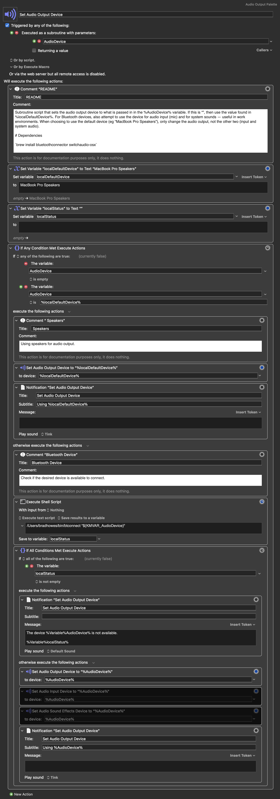

# Introduction

Often times, especially at work, I have the need to switch my AirPods from my iPhone to my laptop in order to use the
AirPods for a meeting. I have two pairs of AirPods Pro, so I need a way to choose from those depending on which one I am
currently wearing, or whichever one I would like to use. I have been a happy user of [Keyboard Maestro][km] for doing
stuff like this, but unfortunately, it is lacking in Bluetooth support. In particular, it cannot query for known
Bluetooth devices, nor affect their connected state. However, once a device is connected to the computer, Keyboard Maestro
can select it to be the destination for system audio output and/or for alerts.

To handle the missing Bluetooth functionality, I found the command-line tool [blueutil][bu] that is installable via
`brew install blueutil`. The `blueutil` offers a way to connect a device:

```shell
% blueutil --connect ADDR
```

where ADDR is the unique address of the device to connect. Here is how to get a list of paired devices:

```shell
% blueutil --paired
address: ec-46-54-1b-9b-1c, not connected, not favourite, paired, name: "AirPods Pro 2", recent access date: 2026-10-31 20:16:28 +0000
address: f4-33-b7-3c-e2-2d, not connected, not favourite, paired, name: "AirPods Pro 3", recent access date: 2026-10-31 20:16:28 +0000
address: c4-f7-c1-08-4a-44, not connected, not favourite, paired, name: "Home Cinema", recent access date: 2026-10-31 20:16:28 +0000
```

This can also be formatted as JSON:

```shell
% blueutil --paired --format json-pretty
[
  {
    "address" : "ec-46-54-1b-9b-1c",
    "recentAccessDate" : "2026-10-31T21:22:08+01:00",
    "favourite" : false,
    "name" : "AirPods Pro 2",
    "connected" : false,
    "paired" : true
  },
  {
    "address" : "f4-33-b7-3c-e2-2d",
    "recentAccessDate" : "2026-10-31T21:22:08+01:00",
    "favourite" : false,
    "name" : "AirPods Pro 3",
    "connected" : false,
    "paired" : true
  },
  {
    "address" : "c4-f7-c1-08-4a-44",
    "recentAccessDate" : "2026-10-31T21:22:08+01:00",
    "favourite" : false,
    "name" : "Home Cinema",
    "connected" : false,
    "paired" : true
  }
]
```

Using [jq][jq] one can select an entry we are interested in and get its address:

```shell
% blueutil --paired --format json-pretty | jq -r '.[] | select(.name | test("AirPods Pro 2")).address'
ec-46-54-1b-9b-1c
```

However, there is a problem. The default query mechanism used by `blueutil` relies on IOBluetoothDevice API, and
apparently this has some issues reporting out correct values, especially the device name set by the user. According to
the documentation obtained using `--help` option, one can switch `blueutil` to use the more robust macOS system_profile
by setting the environment variable `BLUEUTIL_USE_SYSTEM_PROFILER=1` on the command-line.

Keyboard Maestro is for many things but parsing outputs is not its strong suite. So, I dispatch to a small shell script
to interact with `blueutil`.

```shell
#!/bin/bash

PATH="/opt/homebrew/bin:${PATH}"
name="${1}"

if [[ ! -x /opt/homebrew/bin/blueutil ]]; then
  brew install blueutil jq
fi

export BLUEUTIL_USE_SYSTEM_PROFILER=1
paired_args="--paired --format json-pretty"

if [[ -z "${name}" ]]; then
  blueutil ${paired_args} | jq ".[] | {name: .name, address: .address}"
else
  set -- $(blueutil ${paired_args} | jq -r ".[] | select(.name | test(\"${name}\")).address")

  # This bites -- for some reason we could have multiple entries. Assume the last one is what we want, but I do not know
  # if that is sound.
  while (($# > 1)); do
    shift 1
  done
  blueutil --connect "${1}" && exit 0
  echo "*** device ${name} is not paired"
  exit 1
fi
```

The script takes an optional argument: the name of a device to connect. If no option is given, then the output is just
the listing of the known devices in JSON format. Otherwise, the script will scan the list of known devices for the one
that matches the given name, and if found the script attempts to connect the device.

# Keyboard Maestro

Keyboard Maestro provides a way to define a _palette_ of options which can be shown upon an event such as a key press,
similar to a pop-up menu. I have one defined that has 3 options:

1. Set the audio output device to be the built-in speakers
2. Use my "AirPods Pro 2" device to be the output device
3. Use my "AirPods Pro 3" device to be the output device

Pressing ⌘-F12 causes the palette to appear, then pressing a number from 1 to 3 selects the device to use for audio
output. If all goes well, there is a audible beep played on the new audio output device and a notification appears on
the display.



[km]: https://www.keyboardmaestro.com/main/
[bu]: https://github.com/toy/blueutil
[jq]: https://jqlang.org

