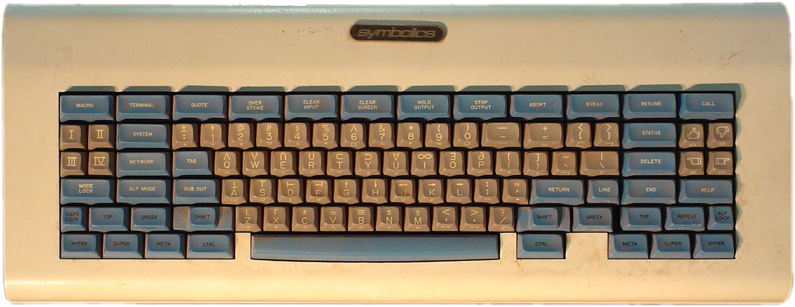
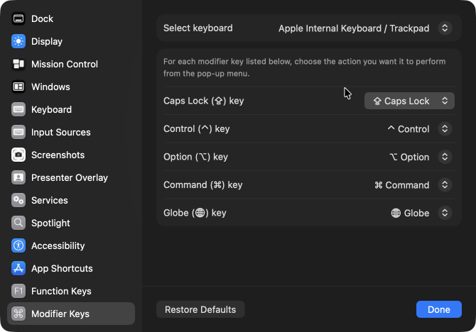
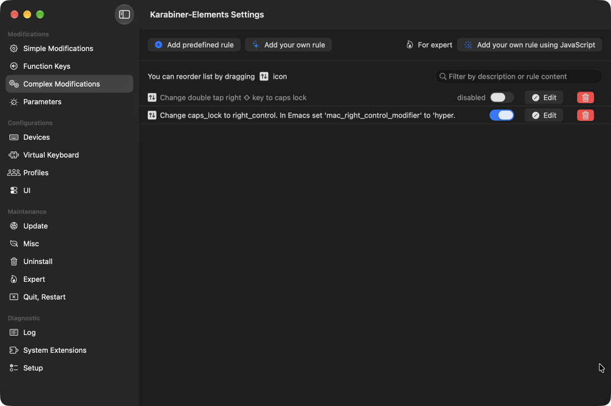

# Introduction

I've been using [Emacs][emacs] since the early 90s when a co-worker showed it to me on his AIX workstation. This was
around v18 I believe. Up until that point I had been using the original [vi][vi] editor on Sun 3/60 boxes at my first
job after graduation, so it took some time for me to get used to the Emacs-way of doing things with complex sequences of
keys and various combinations of modifiers such as "control", "alt" or "meta". However, it stuck and even now I am
typing out this short note on my Apple laptop using Emacs v31.1.

For most of my life I have been happy to use the stock modifiers, but then I saw a picture of the famous ["space-cadet"
keyboard][sck] with its _super_ and _hyper_ modifiers, and I wanted more.

<figure>

<figcaption><a href="https://commons.wikimedia.org/wiki/File:Space-cadet.jpg">Credit</a></figcaption>
</figure>

The problem is that we cannot just add keys, especially on a laptop. But with some crafty tools we can repurpose one
or more existing and rarely-used ones to serve the same purpose.

# Remapping Caps Lock

When editing code -- and honestly in general -- the [caps lock][cl] key sees very, very little use. It is a vestige from
the days of typewriters, same as the (supposedly[^1]) inefficient [QWERTY layout][qwerty] of the keys to reduce jamming
of mechanical typewriters. Some have moved to more enlightened [layouts][layouts], but that is a bridge too far for me.
In an incredible feat of foresight, I took a typing class in the 7th or 8th grade and became a proficient touch typist.

I digress.

On macOS one can change caps lock using the "System Settings" → "Keyboard" → "Keyboard Shortcuts…" → "Modifier
Keys" modal:



However, the only options available are to replicate another modifier key or to disable the key completely. None of
those are sufficient for my purposes: I want to be able to distinguish the pressing of "caps lock".

One solution[^2] is to install [Karabiner-Elements][ke], "a powerful and stable keyboard customizer for macOS." True to
its blurb, it is indeed powerful and with it I can do what I want, but thankfully it is also easy to use. Using the
copious examples found on their [community page][cp], I created two _Complex Modifications_ entries:



The first rule detects a double-tap of the right shift key to toggle the caps lock state of the keyboard so I have not
completely lost the functionality (currently, this is disabled since I do sometimes trigger it by mistake, and I have
yet run into a need for caps lock being on). See the various examples on the [community page][cp] for the JSON code to
do this.

The second rule remaps the caps lock key to emit the *right_control* modifier, which is a key that does not actually
exist on my Apple M1 macBook Pro laptop, but macOS does recognize its existence in software, so it is seen by
applications. Here is the definition of the second rule:

```json
{
  "manipulators": [
    {
      "description": "Change caps_lock to right_control. In Emacs set 'mac_right_control_modifier' to 'hyper.",
      "from": {
        "key_code": "caps_lock",
        "modifiers": { "optional": ["any"] }
      },
      "to": [{ "key_code": "right_control" }],
      "type": "basic"
    }
  ]
}
```

> > Most examples I found on the [community page][cp] remapped the caps lock key to be a combination of multiple modifiers
> such as ⇪ ⌃ ⌥ ⌘ (shift control option command), but this is **not** what I want.

That is all. The keyboard is now ready for Hyper Emacs.

# Hyper Emacs

In general, Emacs supports six (6) modifiers:

- `shift`
- `control`
- `meta`
- `alt`
- `super`
- `hyper`

At least on the Emacs build from [d12frosted][d12] via [homebrew][brew], a stock Emacs (`emacs -Q`) has modifier keys
with the following assignments:

- shift (`S-`) via left and right shift (⇪)
- control (`C-`) via left control (^)
- meta (`M-`) via left and right option (⌥)
- super (`s-`) via left and right command (⌘)

These were divined by using the Emacs `describe-key` command (`C-h`) and then pressing the modifier key and `F7` to see
what Emacs saw.

> Note: by default, macOS performs a system operation when you press a function key. One must press the _fn_ or 🌐
> (Globe) key **and** the function key to have the event reach Emacs. Visit "System Settings" → "Keyboard" → "Keyboard
> Shortcuts…" → "Function Keys" modal to enable sending function key events to applications without the 🌐 key.

> Another note: I had no idea until I was testing that there was an existing mapping for `super`. Super!

Out of the box, Emacs has really good support for macOS. Emacs is able to detect the left *and* right modifier keys, but
by default they both map to the same Emacs modifier symbol. However, one can easily reconfigure the assignments by
adding something like the following to the `init.el` startup file in the `~/.emacs.d` directory (create both if
necessary):

```emacs-lisp
(setopt ns-alternate-modifier 'alt      ; Map alt to option and meta to command
        ns-command-modifier 'meta       ; Much easier to type M-x
        ns-function-modifier super      ; Make 'super available on left side
        ns-right-alternate-modifier 'hyper
        ns-right-command-modifier 'super
        ns-right-control-modifier 'hyper) ; The caps lock mapping from Karabiner
```

With that in place, Emacs now sees the following modifiers:

- shift (`S-`) via left and right shift (⇪) (no change)
- control (`C-`) via left control (^) (no change)
- alt (`A-`) via left option (⌥)
- meta (`M-`) via left command (⌘)
- hyper (`H-`) via caps lock
- super (`s-`) via right command (⌘)
- hyper (`H-`) via right option (⌥)

# Keymaps Galore

Normally, `C-c` is reserved for user bindings, but it is slowly being encroached upon -- in the output from `C-h b`
typed in this [Markdown][md] buffer, I find `C-c` bindings from the `winner` minor mode, and the `markdown-ts-mode`
major mode. But with the availability of `alt`, `hyper` and `super` modifiers, I can easily reorganize things for better
recall[^3]. For instance, I have custom bindings that bring up the `init.el` file (`H-c i`) and my `custom.el` file that
holds _customized_ settings (`H-c ,`). For project bindings, Emacs has the default `C-x p` but that `C-x` is too harsh
to repeatedly type, so I have a dedicated `H-p` to get me there much faster. Same for `C-x 4` and `C-x 5` -- much easier
to just type `H-4` or `H-5` to control where a new window will go (`H-4` for the _other_ window, and `H-5` for a new
frame). Finally, I use Magit for managing git repos, so `H-g` is something I frequently type instead of the much longer
`C-x p v`.

For now, I have three keymaps that all start with a _hyper_ character:

- `H-c` -- for many of my most common functions
- `H-n` -- dedicated to [Denote][denote] note actions
- `H-s` -- newest set for [Symbol Overlay][symbol] functions which I am leaning on more and more

I have yet to do anything with the `super` modifier, and I am loathe to bend my left thumb to activate `alt`, so for now
I think I am done.

# Terminal Emacs

Although I rarely run Emacs in a terminal window, I have found myself in situations where that is the only option, and I
am always bummed to find missing or unsupported key mappings when in an Emacs running in a terminal window. For the
longest time, I suffered through it, but then I came across the nifty [Key Chord][kc] package that recognizes
two-characters typed simultaneously (or one character quickly repeated), and these key chords can be bound to functions
and even key maps. So, I defined "hh" to map to a custom hyper keymap, so that typing "hh" quickly followed by a letter
such as "c" would be treated as the `H-c` key sequence, just as if the hyper key was used along with a "c".

However, I am now using the [Kitty Keyboard Protocol][kkp] package which greatly improves the modifier reporting between
supported terminal programs such as [iTerm2][iterm][^4]. Now, I have the same modifier availability in Emacs when it is run
in iTerm2 as I have when Emacs is running as a native macOS application. Very, very cool.

[emacs]: https://www.gnu.org/software/emacs/
[vi]: https://en.wikipedia.org/wiki/Vi_(text_editor)
[sck]: https://en.wikipedia.org/wiki/Space-cadet_keyboard
[cp]: https://ke-complex-modifications.pqrs.org
[qwerty]: https://en.wikipedia.org/wiki/QWERTY
[cl]: https://en.wikipedia.org/wiki/Caps_Lock
[layouts]: https://en.wikipedia.org/wiki/List_of_Latin-script_keyboard_layouts
[ke]: https://karabiner-elements.pqrs.org
[d12]: https://github.com/d12frosted/homebrew-emacs-plus
[brew]: https://brew.sh
[denote]: https://protesilaos.com/emacs/denote
[symbol]: https://github.com/wolray/symbol-overlay
[md]: https://en.wikipedia.org/wiki/Markdown
[kc]: https://github.com/emacsorphanage/key-chord
[kkp]: https://github.com/benotn/kkp
[iterm]: https://iterm2.com

[^1]: [S. Liebowitz; Stephen E. Margolis (1990), "The Fable of the Keys", _Journal of Law and Economics, 33 (1):
1–26*](https://www.semanticscholar.org/paper/The-Fable-of-the-Keys-Liebowitz-Margolis/c016f8fd28483563fd4e5cad28252d91d2bbce91)
[^2]: [BetterTouchTool may also do this](https://folivora.ai)
[^3]: Moreover, `H-c` is much easier to type than `C-c`. A common solution to
["Emacs pinky"](https://wiki.c2.com/?EmacsPinky) is to swap control and caps lock modifiers.
[^4]: Apparently, there is work to bring this functionality into Emacs core.
